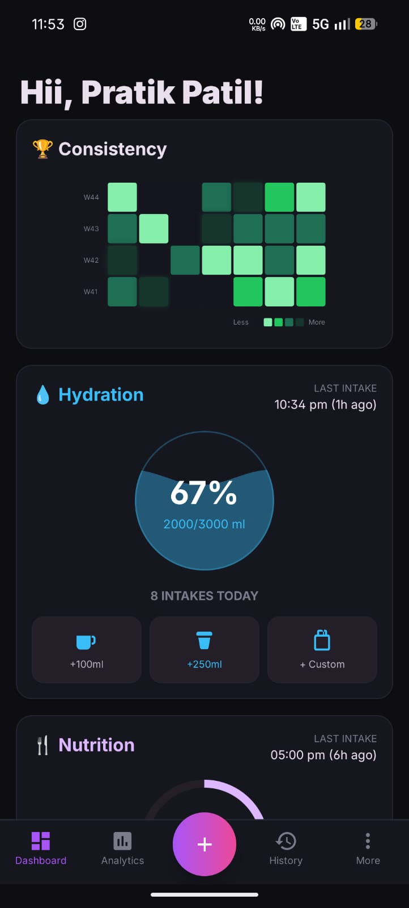
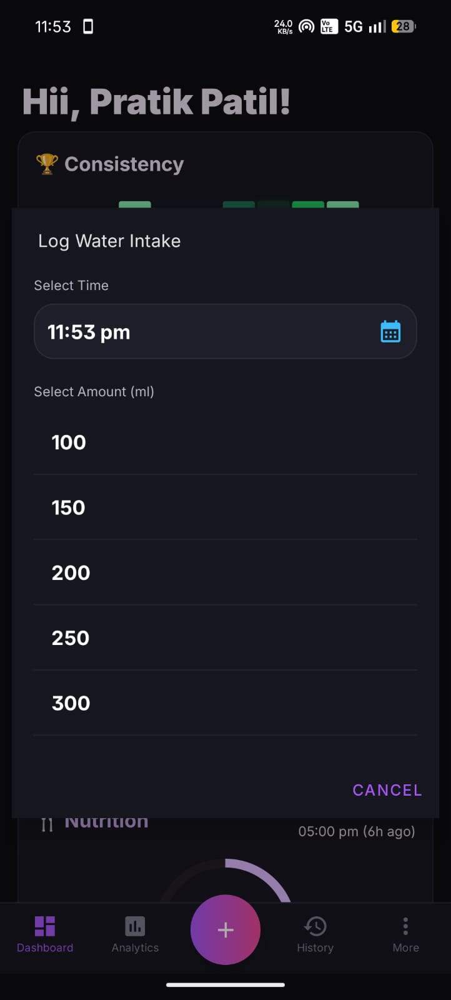
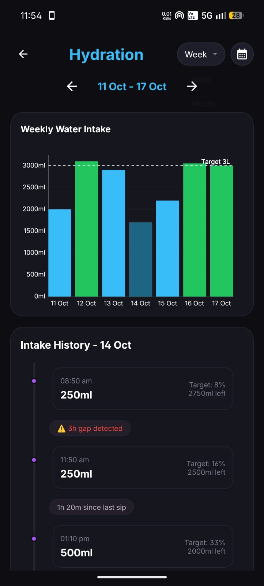
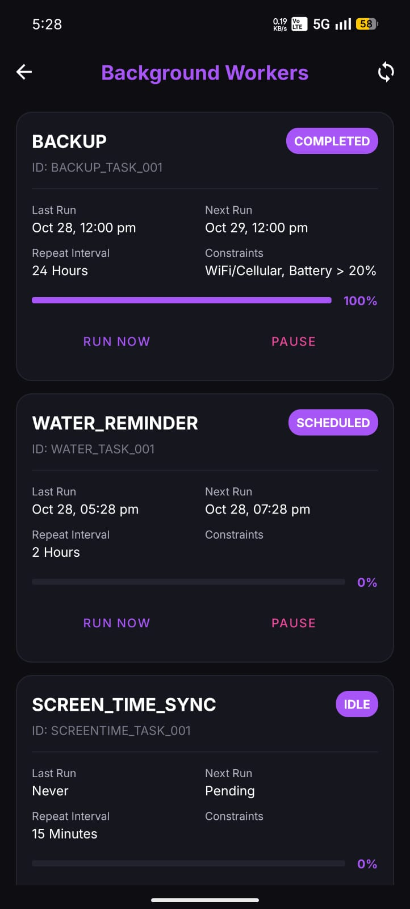

<div align="center">

# 💧 Intelligent Hydration Tracking & Smart Scheduling Module
### *A Local-First, Smart Interval-Scheduled Hydration & Water Intake System for Android*

<p align="center">
  <b>Never forget to stay hydrated. This module combines smart interval reminders, interactive quick-logging, daily target progress tracking, and visual trend analytics to motivate healthy hydration habits—completely offline and privacy-first.</b>
</p>

</div>

## 🎯 What Makes This Different?

Standard hydration apps rely on intrusive fixed alarms or tedious manual entries that disrupt daily flow. **`Personal Tracker's Hydration Module`** is engineered to maximize user engagement, build consistent habits, and keep you motivated toward your daily goals:

1. 🔒 **`100% Local-First & Private`**: All hydration logs stay securely on device in local persistence. Zero cloud tracking or third-party server exposure.
2. ⏰ **`Smart Periodic Reminder Engine`**: Calculates dynamic reminders exactly **2 hours after your last drink** to maintain steady hydration, operating strictly between **11:00 AM and 11:00 PM** to protect your rest hours.
3. 🔔 **`Frictionless Quick-Log Notifications`**: Log standard intake (+250 ml, +300 ml), request a custom volume, or snooze for 1 hour directly from the interactive Android notification shade without interrupting your current task.
4. 🌙 **`Late-Night Auto-Adjustment`**: Intakes logged between 12:00 AM and 3:00 AM automatically map to 23:59 of the previous day, preserving accurate goal totals for night owls.
5. 📊 **`Visual Trends & Goal Motivation`**: Interactive weekly and monthly analytics provide actionable insights and visual feedback, encouraging users to consistently reach their daily target (3,000 ml default).

---

## 🎨 High-Level Architecture Flow

```
┌─────────────────────────────┐
│ Quick Log / Notification    │
└──────────────┬──────────────┘
               │
               ▼
┌─────────────────────────────┐      ┌─────────────────────────────────┐
│  Late-Night Auto-Adjust     ├─────►│    Local Offline Database       │
└──────────────┬──────────────┘      └────────────────┬────────────────┘
               │                                      │
               ▼                                      ▼
┌─────────────────────────────┐      ┌─────────────────────────────────┐
│   Water Intake Scheduler    │ ──►  │ Dynamic Alarm (11 AM - 11 PM)   │
└──────────────┬──────────────┘      └────────────────┬────────────────┘
               │                                      │
               ▼                                      ▼
┌─────────────────────────────┐      ┌─────────────────────────────────┐
│  5-Min Bucket Aggregation   │ ──►  │ Interactive Analytics & Trends  │
└─────────────────────────────┘      └─────────────────────────────────┘
```

---

## ⚡ Feature Capabilities & System Flow

### 1. 📲 Frictionless Intake Ingestion & Late-Night Adjustment
Maximizes user engagement by providing zero-friction logging across the app dashboard and system notifications.

- 🥛 **`Preset & Custom Ingestion`**: One-tap quick buttons (+250 ml, +300 ml) and custom volume dialogs allow instant intake logging.
- 🌙 **`Late-Night Adjuster`**: Intakes recorded between 12:00 AM and 3:00 AM are automatically shifted to 23:59 of the previous active day, ensuring goal progress accurately reflects the active waking cycle.
- ⚡ **`Thread-Safe Operations`**: Intakes and reschedule routines execute sequentially in background routines to eliminate race conditions.

---

### 2. ⏰ Smart Reminders & Motivational Alarm Engine
Keeps users accountable to their hydration goals without feeling intrusive or firing during rest hours.

- 🔄 **`Periodic 2-Hour Reminders`**: Calculates and queues the next reminder for **2 hours after the latest logged drink**, keeping water intake steady throughout the day.
- 🎯 **`Bounded Active Window`**: Reminders trigger strictly between **11:00 AM** and **11:00 PM**. If the next calculated intake falls after 11:00 PM, the system automatically queues the alarm for 11:00 AM the following morning.
- 💤 **`Snooze & Persistent Nudges`**: Supports 1-hour snoozing via notification actions and schedules a 20-minute repeat reminder if a notification remains unacknowledged, gently prompting the user to complete their next water intake.
- ⏰ **`System Wakeup Delivery`**: Guarantees alarm delivery even when the device enters power saving modes.

---

### 3. 📊 Visual Trend Analytics & Goal Motivation
Empowers users to track their progress, analyze consumption patterns, and stay motivated toward long-term wellness targets.

- 📈 **`Multi-Period Historical Views`**: Easily switch between **Weekly** and **Monthly** analytical screens to evaluate overall intake consistency.
- 📊 **`Visual Goal Tracking`**: Dynamic bar charts render daily consumption against target goals (3,000 ml default), providing positive visual reinforcement as users approach and achieve their daily targets.
- 🧮 **`5-Minute Bucket Aggregation`**: Smart windowing groups rapid sequential drinks into consolidated intake entries for clean, noise-free trend reports.

---

### 4. 🛡️ System Audit Logging & State Synchronization
All alarm events and background executions are logged for maximum reliability.

- 📝 **`Audit History`**: Operations (`SCHEDULE`, `SNOOZE`, `CANCEL`) write structured execution logs to monitor background job performance.
- 🔄 **`Dashboard State Integration`**: Synchronizes next scheduled reminder times and intake statistics seamlessly across the application dashboard.

---

## 📸 UI Screenshots & Feature Gallery

|                                          🌊 1. Dashboard Wave Card                                          | 🥛 2. Custom Intake Dialog | 🔔 3. Notification Quick Actions |
|:-----------------------------------------------------------------------------------------------------------:| :---: | :---: |
|  |  |  |

| **📊 4. Trend Analytics & Goals** | **⚙️ 5. Worker Execution Audit Logs** |
| :---: | :---: |
|  |  |

---

## 🎯 Summary

1. 💧 **`Ingestion`**: Water intake logged via UI preset buttons, custom dialog, or interactive notification actions.
2. 🕒 **`Adjustment`**: Late-night logs (< 3 AM) auto-adjust to the previous day's 23:59 timestamp to maintain goal accuracy.
3. ⏰ **`2-Hour Reminders`**: Periodic reminders schedule the next alarm 2 hours post-intake (bounded strictly between 11 AM – 11 PM).
4. 🔔 **`Notification Shade`**: Interactive notifications support +250ml, +300ml, 1-hour snooze, and 20-minute repeat nudges.
5. 📊 **`Analytics & Motivation`**: Visual trend charts and multi-period reporting encourage users to meet and sustain their daily intake targets.

