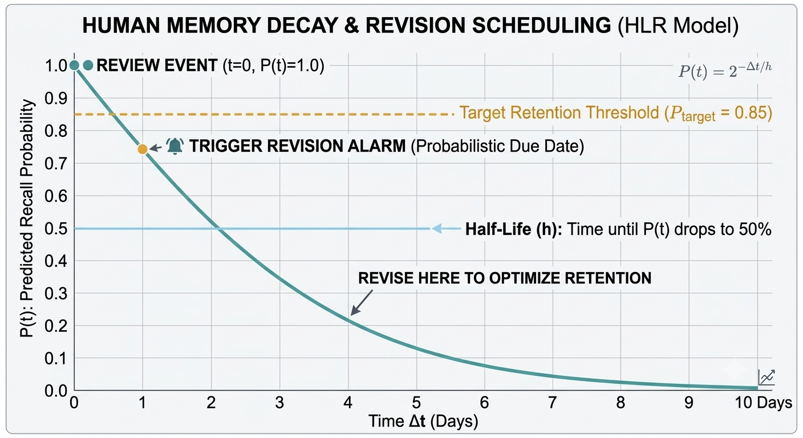

<div align="center">

# 🔤 Intelligent Vocabulary Module - High-Level Technical Overview
### *A Local-First, Machine Learning-Driven Spaced Repetition System for Android*

<p align="center">
  <b>Move beyond static flashcards. This module harnesses Half-Life Regression (HLR) and stochastic weight optimization to adapt to your personal human memory curve—completely offline and privacy-first.</b>
</p>

</div>

## 🎯 What Makes This Different?

Most flashcard applications rely on rigid, one-size-fits-all algorithms (like fixed interval SM-2) and require tedious manual data entry. **`Personal Tracker's Vocabulary Module`** is built differently to solve these exact shortcomings:

1. 🔒 **`100% Local-First & Private`**: Your learning data and personal vocabulary never touch remote third-party servers. Complete local SQLite persistence ensures zero risk of data tracking or cloud leakage.
2. 🌐 **`Contextual Daily Capture`**: Don't study sterile, pre-made vocabulary lists. Ingest words naturally straight from your day-to-day life—highlight text in your browser, e-reader, or news app and share it instantly into the app via Android Share Intents (`ACTION_SEND`).
3. 🤖 **`AI-Powered Auto-Completion`**: Automatically parses and fills missing parts of speech, definitions, and natural usage examples using Google Gemini (`gemini-3.8-flash`).
4. 📈 **`Adaptive Machine Learning Engine`**: Replaces static spacing with a **`probabilistic memory decay model`** powered by **`Half-Life Regression (HLR)`** and **`Stochastic Gradient Descent (SGD)`** that morphs according to your actual 1–5 star human feedback.

---

## 🎨 High-Level Architecture Flow

```
┌─────────────────────────┐
│ Share Intent / UI Input │
└────────────┬────────────┘
             │
             ▼
┌─────────────────────────┐      ┌─────────────────────────────────┐
│   Database Persistence  ├─────►│  LLM Auto-Completion (Gemini)   │
└────────────┬────────────┘      └─────────────────────────────────┘
             │
             ▼
┌─────────────────────────┐
│   Half-Life ML Engine   │ ──► Calculates optimal due date
└────────────┬────────────┘
             │
             ▼
┌─────────────────────────┐
│   Background Scheduler  │ ──► Triggers scheduled notification window
└────────────┬────────────┘
             │
             ▼
┌─────────────────────────┐
│ Interactive Notification│ ──► Captures 1–5 ★ user rating
└────────────┬────────────┘
             │
             ▼
┌─────────────────────────┐
│  SGD Weight Adjustment  │ ──► Online model optimization
└────────────┬────────────┘
```

---

## ⚡ Feature Capabilities & System Flow

### 1. 📲 Ingestion & Share Intent Integration
Users can add vocabulary words directly within the app or share highlighted text from external Android apps (browsers, reader apps, e-books) using the standard Android system share menu (`Intent.ACTION_SEND`).

- 🔤 **`Single Word`**: Inserts a new vocabulary entry initialized with baseline memory parameters.
- 🏷️ **`Part of Speech`**: Text matching `"noun"`, `"verb"`, `"adjective"`, or `"adverb"` is automatically attached as the part of speech for the most recently added word.
- 📝 **`Definitions (>3 words)`**: Text with more than three words is automatically attached as the definition/meaning for the last added word.

---

### 2. 🤖 LLM Enrichment & Auto-Completion
When vocabulary items have missing details (part of speech, definition, or usage example), the system leverages Google Gemini LLM to enrich them automatically.

- 📝 **`Prompt Engine`**: Formats structured prompt templates passing the word and existing context to the LLM.
- 🔄 **`Modes of Execution`**:
  - ⚙️ **`Background Worker`**: Periodically fetches incomplete words from the database and updates missing fields without user intervention.
  - 🖥️ **`Interactive UI Batch`**: Allows users to manually trigger batch auto-completion with real-time progress updates on screen.

---

### 3. ⏰ Revision Scheduling & Notifications
To avoid overwhelming the user while ensuring timely reviews, revision notifications are queued into fixed daily time windows.

- 📅 **`Daily Schedule Windows`**: `12:30`, `15:30 (3:30 PM)`, `17:30 (5:30 PM)`, `19:00 (7:00 PM)`, and `23:30 (11:30 PM)`.
- 🎯 **`Word Selection Strategy`**: Queries the database for overdue vocabulary items based on target recall probability, falling back to the oldest reviewed items if no items are currently overdue.
- 🔔 **`Interactive Notification Cards`**:
  1. Displays the vocabulary word.
  2. Provides an interactive option to reveal a **`Hint`**.
  3. Prompts for **`Remembered`** vs. **`Forgotten`**.
  4. Allows selecting a **`1 to 5 Star Rating`** directly from the notification shade to log recall difficulty.

---

### 4. 🧠 Machine Learning & Half-Life Decay Model
Standard spaced-repetition platforms rely on rigid, fixed intervals. This module mathematically models the **`Ebbinghaus Forgetting Curve`** for each individual word using **`Half-Life Regression (HLR)`**.

#### 📊 Conceptual Memory Retention Curve



#### 📐 Mathematical Foundation

1. **`Half-Life Calculation (h)`**  
   Predicts the memory duration (in days) until recall probability drops to 50%, governed by model weights $(w_0, w_1, w_2)$ and interaction history:

   ```
   Half-Life (h) = 2^(w₀ + (w₁ × correctAttempts) + (w₂ × incorrectAttempts))
   ```

2. **`Recall Probability P(t)`**  
   The mathematical likelihood of recalling a word after elapsed time $\Delta t$ (in days) since its last review:

   ```
   P(t) = 2^(-Δt / h)
   ```

3. **`Adaptive Due Date Computation`**  
   Words are auto-scheduled precisely when user memory probability decays to the Target Retention Threshold (85% or 0.85):

   ```
   Δt_due = -h × log₂(0.85)
   Timestamp_due = Timestamp_lastReviewed + Δt_due
   ```

#### ⭐ Review Rating to Performance Weights
User feedback (1 to 5 Stars) is mapped into fractional credit/penalty deltas:

- ⭐ **1 Star (Complete failure)**: $+0.0$ correct, $+1.0$ incorrect
- ⭐⭐ **2 Stars (Forgot/Hard)**: $+0.0$ correct, $+0.5$ incorrect
- ⭐⭐⭐ **3 Stars (Good/Pass)**: $+0.3$ correct, $+0.0$ incorrect
- ⭐⭐⭐⭐ **4 Stars (Great)**: $+0.7$ correct, $+0.0$ incorrect
- ⭐⭐⭐⭐⭐ **5 Stars (Mastered)**: $+1.0$ correct, $+0.0$ incorrect

#### 🔄 Stochastic Gradient Descent (SGD) Model Tuning
Model weights $(w_0, w_1, w_2)$ are updated online using Stochastic Gradient Descent (SGD) with a learning rate $\alpha = 0.01$ to minimize prediction error between predicted recall $P(t)$ and actual recall outcome $y$:

```
Error = P(t) - y

w₀ = w₀ - (α × Error × 1.0)
w₁ = w₁ - (α × Error × correctAttempts)
w₂ = w₂ - (α × Error × incorrectAttempts)
```

---

## 🎯 Summary

1. 📥 **`Ingestion`**: Words are received from standard share intents or manual entry.
2. 🤖 **`Auto-Complete`**: Missing fields are enriched using Google Gemini LLM.
3. ⏱️ **`Scheduling`**: Background alarms trigger fixed daily windows and select overdue words.
4. 🔔 **`Interactive Review`**: User rates recall (1–5 Stars) directly from notifications or UI.
5. 🧠 **`Memory Update`**: The memory engine updates half-life $h$, recalculates next revision date, logs review history, and optimizes model weights using SGD.
